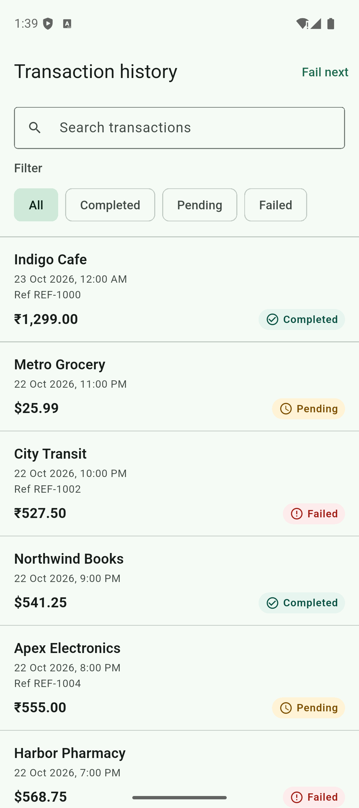
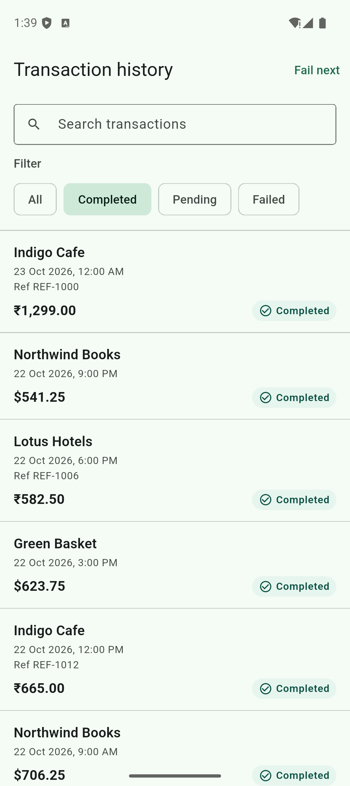
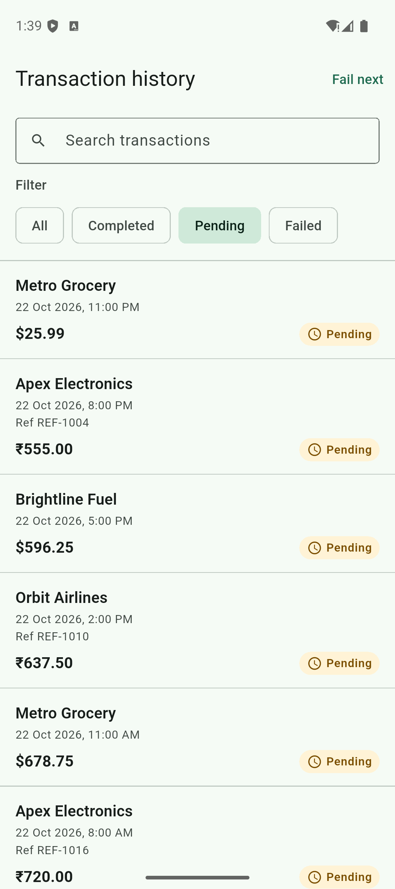
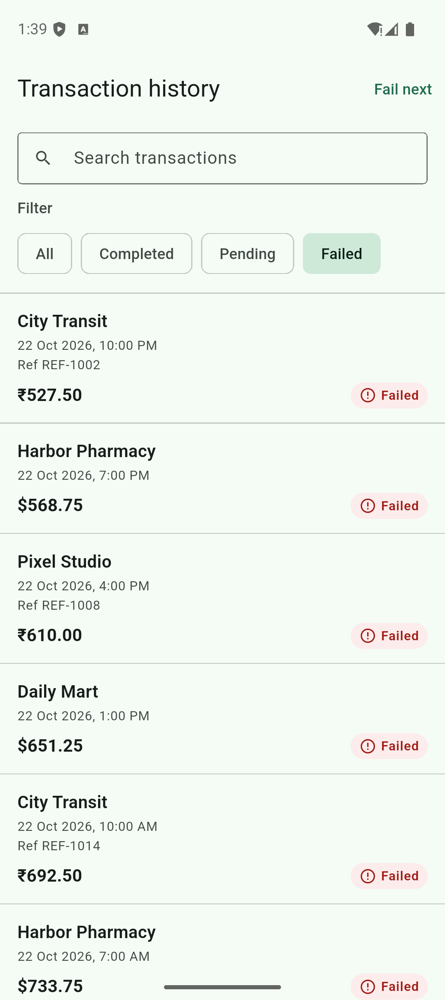
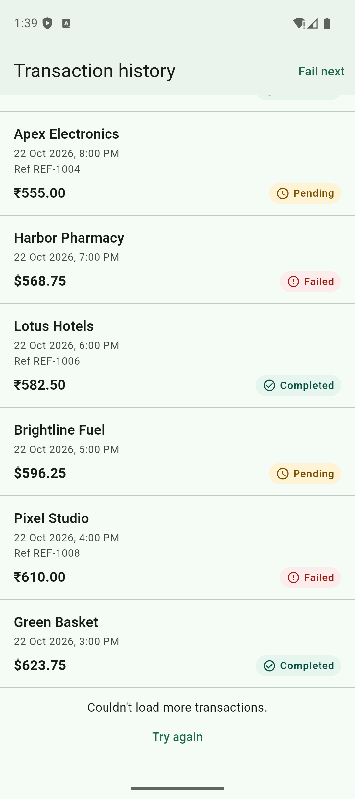
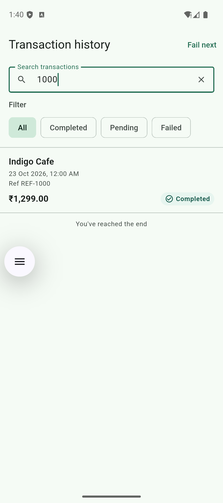

# bepay transaction history

A small Flutter app that shows a paginated transaction history. It runs entirely on a local fake data source. No credentials, backend, or network access are required.

## Screenshots

| All | Completed | Pending |
| --- | --- | --- |
|  |  |  |

| Failed | Next-page error | Search |
| --- | --- | --- |
|  |  |  |

## 1. Toolchain and commands

- Flutter 3.35.6
- Dart 3.9.2

```sh
flutter pub get
flutter analyze
flutter test
flutter run
```

`flutter run` targets an Android or iOS simulator. The default fake source waits 600ms so loading, paging, and refresh are visible.

## 2. Architecture

The screen is one feature. Widgets send events. The BLoC calls a use case. The repository forwards that call to the fake data source. Business rules do not live in widgets.

```
TransactionHistoryScreen
        |  events: start, filter, load more, refresh, retry
        v
TransactionHistoryBloc
        |  FetchTransactions
        v
TransactionRepository
        |
        +-- TransactionRepositoryImpl
                |
                +-- FakeTransactionDataSource
```

BLoC fits this screen because each user action is a distinct event. Scroll events use a `droppable` transformer, so a burst of scroll notifications cannot start two page requests. Filter, refresh, and retry use a `concurrent` transformer, so a newer tap is not stuck behind a slow request. Every fetch takes a generation number. A response is applied only when that number is still the latest one, which keeps an older filter, refresh, or page from overwriting a newer result.

Money stays an `int` in minor units (`129900` means INR 1,299.00). `formatMoney` is the only place that turns that integer into text, and it uses integer division.

### What each file does

| File | Role |
| --- | --- |
| `lib/main.dart` | Starts the app with the fake source and the "Fail next" control. |
| `lib/app.dart` | `MaterialApp`, theme, and the BLoC that loads the first page. |
| `lib/core/constants/app_constants.dart` | Strings, colors, and the light theme. |
| `lib/core/errors/app_exception.dart` | The error thrown when a fetch fails. |
| `lib/core/utils/currency_formatter.dart` | Turns minor units into `₹1,299.00` or `$25.99`. |
| `lib/core/utils/date_formatter.dart` | Shows a UTC timestamp in the phone's local time. |
| `lib/features/transactions/domain/entities/transaction.dart` | The transaction and the sort order. |
| `lib/features/transactions/domain/enums/transaction_status.dart` | Completed, pending, and failed. |
| `lib/features/transactions/domain/models/transaction_page.dart` | One page: rows plus the next page token. |
| `lib/features/transactions/domain/repositories/transaction_repository.dart` | The fetch contract the use case depends on. |
| `lib/features/transactions/domain/usecases/fetch_transactions.dart` | Asks the repository for a page. |
| `lib/features/transactions/data/datasources/fake_transaction_data_source.dart` | 36 fixed rows, pages of 10, status and text search, delay, and deterministic failures. |
| `lib/features/transactions/data/repositories/transaction_repository_impl.dart` | Passes each fetch through to the fake source. |
| `lib/features/transactions/data/cache/shared_preferences_first_page_cache.dart` | Saves the last successful first page on the device. |
| `lib/features/transactions/data/cache/memory_first_page_cache.dart` | In-memory stand-in used by tests. |
| `lib/features/transactions/presentation/bloc/transaction_event.dart` | Start, filter, load more, refresh, and retry. |
| `lib/features/transactions/presentation/bloc/transaction_state.dart` | Immutable screen state: rows, page token, filter, and which failure is showing. |
| `lib/features/transactions/presentation/bloc/transaction_bloc.dart` | Applies events, ignores stale responses, and refuses duplicate pages. |
| `lib/features/transactions/presentation/screens/transaction_history_screen.dart` | The screen: search, filters, list, refresh, and the loading, empty, and error states. |
| `lib/features/transactions/presentation/screens/transaction_details_screen.dart` | One transaction opened from a row. |
| `lib/features/transactions/presentation/widgets/transaction_search_field.dart` | Merchant and reference search. |
| `lib/features/transactions/presentation/widgets/transaction_filter_bar.dart` | All / Completed / Pending / Failed chips. |
| `lib/features/transactions/presentation/widgets/transaction_list_item.dart` | One row: merchant, local date, amount, reference, status. |
| `lib/features/transactions/presentation/widgets/transaction_list_view.dart` | The list, the next-page spinner, and the end of the list. |
| `lib/features/transactions/presentation/widgets/transaction_loading_view.dart` | First-page and next-page loading. |
| `lib/features/transactions/presentation/widgets/transaction_empty_view.dart` | Empty filter state. |
| `lib/features/transactions/presentation/widgets/transaction_error_view.dart` | First-page error, refresh banner, and next-page retry. |
| `test/core/utils/currency_formatter_test.dart` | INR and USD formatting, including a value that does not fit in a float. |
| `test/core/utils/date_formatter_test.dart` | Local-time formatting. |
| `test/features/transactions/data/fake_transaction_data_source_test.dart` | Paging, filtering, search, sort tie-break, and failures. |
| `test/features/transactions/data/first_page_cache_test.dart` | Saving and restoring the first page. |
| `test/features/transactions/bloc/transaction_bloc_test.dart` | Paging to the end, next-page failure and retry, stale filter, stale refresh, duplicate scroll, search, and the saved page. |
| `test/features/transactions/presentation/transaction_history_screen_test.dart` | Widget coverage for formatting, filtering, search, details, the saved page, first-page retry, and a narrow layout with larger text. |
| `test/features/transactions/bloc/pausable_transaction_repository.dart` | Test double that holds a response until the test releases it. |

Sort order is newest `createdAt` first. If two timestamps match, the higher `id` comes first.

## 3. Failure scenarios

In the running app, tap **Fail next** in the app bar, then pull to refresh, change the filter, or scroll to the next page. The next request that has not already started fails once. Requests already in flight are not affected. After that failure:

- A failed first page replaces the list with an error and **Try again**.
- A failed next page leaves the rows on screen and shows **Try again** under the list.
- A failed refresh leaves the rows on screen and shows a banner.

Retry uses a new request, so it succeeds unless you tap **Fail next** again.

Tests construct the same behavior without the button:

```dart
FakeTransactionDataSource(delay: Duration.zero, failOnCalls: {1});
FakeTransactionDataSource(delay: Duration.zero, failOnCalls: {2});
FakeTransactionDataSource(delay: Duration.zero, failAllRequests: true);
```

`failOnCalls` uses 1-based call numbers counted when the call starts. Call 2 can be a next page or a refresh, depending on what the test does first. `armFailNextRequest()` is what the app bar button calls.

There is no randomness. The same calls fail on every run.

## 4. Tradeoffs and limitations

- One state object carries the list, the next-page spinner, and the error together. Sealed "loading / success / failure" states hide the fact that a next-page failure must keep the rows.
- The cursor is an offset into the current filtered list. That is deterministic for this fixed source. A production API should use a keyset cursor (`createdAt` + `id`) so a new row cannot shift later pages.
- The repository only forwards the call to the fake source. It does not cache or map a remote API.
- Amounts use western thousands separators (`₹1,299.00`), matching the assignment example, not Indian lakh grouping.
- The app is light theme only.
- **Fail next** is a review control, not a production action.
- The scroll listener asks for the next page when the user is within 280 pixels of the end. The BLoC drops extra requests while one page is loading.

The last successful first page is stored on the device. After a restart that page is shown immediately, with a thin progress bar, until the fresh request replaces it. A failed refresh keeps those rows. Search matches the merchant name or reference, ignoring letter case. It runs on the full sample list together with the status filter, and that result is what gets paged. Changing the search or the filter starts again at the first page. Tapping a row opens the merchant, amount, status, date, reference, and id.

With more time I would switch the cursor to a keyset and cover dark mode.

## 5. Time spent

Approximately 1 hour 30 minutes

